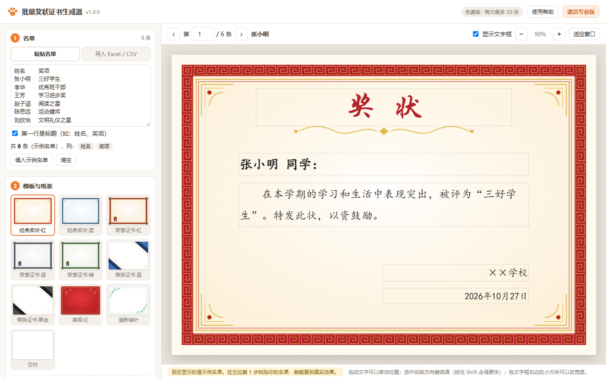
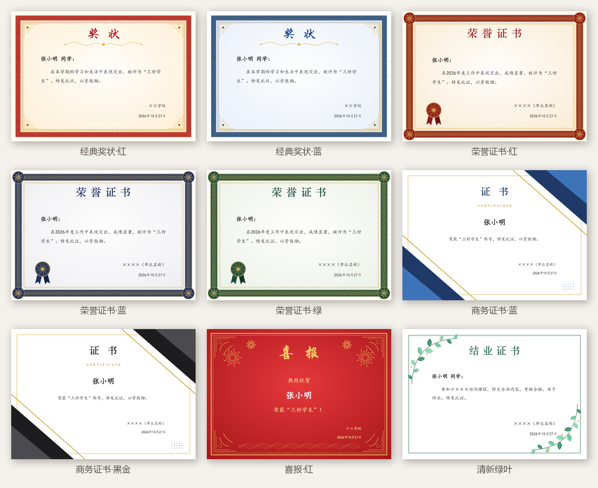

# 批量奖状证书生成器（离线 · 免安装）

把 Excel 名单一次变成整套**奖状、荣誉证书、结业证书、喜报**。双击就能用，不用安装，不用联网，名单不会上传。

适合：期末奖状、三好学生、运动会、比赛获奖、员工表彰、培训结业证书、电子证书……

## 免费下载

- **国内下载（推荐）**：[蓝奏云](https://wwbek.lanzoup.com/iXZv84dloang)，密码 `g8us`
- 备用下载：[batch-certificate-maker-v1.0.2.zip](https://github.com/catpawtools/batch-certificate-maker/raw/main/download/batch-certificate-maker-v1.0.2.zip)

下载后解压，双击 `批量奖状生成器.html`，用 **Edge** 或 **Chrome** 打开即可。

## 能做什么

- **批量生成**：从 Excel 复制名单粘贴进来，或直接导入 `.xlsx` / `.csv`。`{姓名}`、`{奖项}` 这样的地方自动换成每个人的信息。
- **10 款内置模板**：经典奖状（红 / 蓝）、荣誉证书（红 / 蓝 / 绿）、商务证书（蓝 / 黑金）、喜报、结业证书，也可以上传自己的背景图。
- **套打**：只打印文字，直接打在买来的空白奖状纸上，支持打印位置微调。
- **打印 / 导出 PDF**：A4、A3、8 开、16 开或自定义尺寸，一次全部输出。
- **导出图片**：每人一张 PNG，适合发微信群、公众号的电子证书。
- **好用的细节**：拖动摆放文字，方向键微调，名字太长自动缩小，设置自动保存，可以存成方案文件。
- **隐私安全**：所有处理都在你自己的电脑上完成，不联网、不上传。

## 三步做好一批奖状

1. **名单**：在 Excel 里选中名单（可以带标题行，比如"姓名、奖项"），复制，粘贴到第 1 步。
2. **模板**：选一个模板，在预览里把文字拖到合适的位置。
3. **打印**：点"打印 / 保存为 PDF"。打印窗口里边距选"无"，缩放选"默认"；想要 PDF 文件就把打印机选成"另存为 PDF"。

## 免费版和专业版

|                | 免费版     | 专业版   |
| -------------- | ---------- | -------- |
| 全部模板和功能 | ✓          | ✓        |
| 每次输出数量   | 最多 3 张  | **不限** |
| 以后的更新     | ✓          | ✓        |

专业版激活码在 **[爱发电 · 猫爪工具铺](https://ifdian.net/a/catpawtools)** 购买，付款后激活码自动发到你的爱发电私信。在工具右上角点"激活专业版"，粘贴即可。

## 常见问题

**字体和预览不一样？** 字体列表里标着"本机没有"的字体，这台电脑没有安装，会用相近的字体代替。换一个已安装的字体即可。

**怎么打在已经印好的奖状纸上？** 勾选"套打模式"，上传一张空白奖状的照片用来对位置（照片不会被打印），把文字拖到对应位置，先用白纸试打，再用"打印位置微调"修正。

**旧版 `.xls` 文件打不开？** 在 Excel / WPS 里"另存为 `.xlsx`"，或者直接复制粘贴名单。

**支持哪些浏览器？** 推荐 Windows 自带的 Edge，或 Chrome、360 极速浏览器等新版浏览器。

## 版权

© 猫爪工具铺。免费版可以免费用于个人、学校和单位，请勿转售或改名重新发布。模板花纹均为原创绘制。
